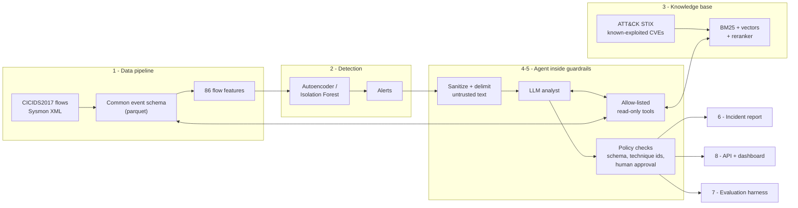

# SentinelAI - Autonomous AI SOC Analyst

[](https://github.com/Adityakumarjha087/sentinelai/actions/workflows/ci.yml)

A defensive security system that ingests security logs, detects anomalies with
ML, investigates alerts with an LLM agent, maps them to MITRE ATT&CK, enriches
them with threat intelligence (RAG) and writes incident reports - while treating
every byte of log content as untrusted, so text hidden in a log cannot hijack
the analyst.

> **Defensive use only.** This project contains no offensive tooling.

## Status

| Phase | Scope | State |
|---|---|---|
| 1 | Data pipeline: download, parse, normalize, feature engineering | **Done** |
| 2 | Detection models (Isolation Forest + PyTorch autoencoder), MLflow | **Done** |
| 3 | Knowledge base: MITRE ATT&CK + NVD, hybrid retrieval | **Done** |
| 4 | Investigation agent with tools and structured verdicts | **Built; not yet run against a live LLM** |
| 5 | Guardrails: sanitization, injection detector, tool allow-list | **Partly done** (heuristic detector; DistilBERT classifier not built) |
| 6 | Incident reports (Markdown / PDF) | **Done** |
| 7 | Evaluation harness | **Harness done**; run only with offline baselines, not a real LLM |
| 8 | Dashboard + API | **Done**: host events and Phase 2 flow detections, investigated with the knowledge base; offline analyst only (no LLM run yet) |
| 9 | Docker, CI, final documentation | CI passing; `docker compose up` verified locally (API + dashboard); no demo GIF |

## Architecture



Everything in the diagram is wired together except a real LLM: the API and
dashboard score a CICIDS2017 day with the saved detector and investigate the
flagged flows (and the Sysmon sample) against the knowledge base, using the
offline rule-based analyst until an LLM is configured. Scoring is a batch over
one day's file, not a live stream.

## Layout

```
sentinelai/
├── common/          shared settings (env-driven, no hardcoded secrets)
├── data/            Phase 1 - data pipeline
│   ├── schema.py        common event schema (Pydantic model + typed DataFrame)
│   ├── download.py      checksum-verified, atomic dataset download
│   ├── parsers/
│   │   ├── cicids.py    CICIDS2017 labelled flows (CSV or parquet)
│   │   └── sysmon.py    Sysmon Windows Event XML (defusedxml)
│   ├── normalize.py     streaming parquet writer / loader
│   ├── features.py      leakage-aware flow feature engineering
│   ├── synthetic.py     synthetic flows for offline demos and tests
│   ├── cli.py           `sentinel-data` command
│   ├── samples/         small synthetic Sysmon sample (committed)
│   ├── raw/             downloads (git-ignored)
│   └── processed/       normalized events + feature tables (git-ignored)
├── detection/       Phase 2 - anomaly detection
│   ├── dataset.py       benign-only train split, stratified validation/test
│   ├── models.py        Isolation Forest and autoencoder behind one interface
│   ├── metrics.py       threshold selection, precision/recall/F1/AUC
│   ├── train.py         `sentinel-detect`: train, compare, track, save best
│   └── service.py       score a day of flows, sample the flagged ones into a feed
├── rag/             Phase 3 - ATT&CK / CVE knowledge base
│   ├── documents.py     STIX and NVD parsing, chunking
│   ├── embeddings.py    sentence-transformers and offline hashing embedders
│   ├── retriever.py     BM25 + ChromaDB vectors, RRF fusion, cross-encoder rerank
│   └── cli.py           `sentinel-kb build` / `sentinel-kb search`
├── agent/           Phases 4 and 6 - investigation agent, tools, incident reports
│   └── fonts/           DejaVu Sans for PDF reports (Bitstream Vera licence)
├── guardrails/      Phase 5 - prompt-injection defences
├── eval/            Phase 7 - evaluation harness (`sentinel-eval`)
├── api/             Phase 8 - FastAPI backend (`api.main.create_app`)
│   └── resources.py     loads the sample, knowledge base and detector when built
├── ui/              Phase 8 - Streamlit dashboard (`ui/app.py`)
└── tests/           pytest suite, mirrors the package layout
```

## Quick start

Requires Python 3.11 and [uv](https://docs.astral.sh/uv/).

```bash
make install      # create .venv and install dependencies
make check        # ruff + mypy --strict + pytest
make demo-data    # offline: synthetic flows through the whole pipeline
make data         # real CICIDS2017 (~306 MB download, ~2 min processing)
make train        # train both detectors, log to MLflow, save the best (~1 min)
make mlflow-ui    # browse the tracked runs
make kb           # download ATT&CK + known-exploited CVEs and build the index
make eval         # end-to-end evaluation with the offline analysts
make api          # HTTP API at http://127.0.0.1:8000/docs
make ui           # Streamlit dashboard
```

### Docker

```bash
docker compose up --build
# API        http://localhost:8000/docs
# Dashboard  http://localhost:8501
```

Built artifacts are mounted read-only when they exist: `models/` (`make train`)
and `data/processed/` (`make data`, `make kb`). Without them both services
start on the Sysmon sample alone, and `/health` lists what is missing and the
command that builds it. The embedding and reranking models are baked into the
image, so containers need no network at run time. Chroma cannot open a
read-only index, so the loader opens a private temporary copy of it.

Verified on Docker 29.7 / Compose v5.5 (Apple silicon, so a `linux/arm64`
image), with and without the artifacts mounted: the API turns healthy (about
40 s with the knowledge base and detector), `/detections`, `/kb/search` and
`/investigate` respond, and the dashboard renders both feeds and investigates
without errors. The image is about 1.3 GB compressed (6 GB unpacked), mostly
PyTorch and the ML stack. The `linux/amd64` image has not been built.

One image serves both; the dashboard runs investigations in-process rather
than calling the API. Containers run as an unprivileged user with all Linux
capabilities dropped, ports are bound to localhost only, and the API container
has a read-only filesystem. Linux builds use CPU-only PyTorch wheels.

Configuration lives in environment variables (see `.env.example`); copy it to
`.env` to override defaults. `.env` is git-ignored.

## Phase 1 - data pipeline

```
raw logs ──> parser ──> common schema (parquet) ──> FlowFeaturizer ──> feature tables
CICIDS2017 flows        timestamp, src_ip, dst_ip,   fit on benign       float32, finite,
Sysmon XML              process, user, event_type,   baseline only       86 features/flow
                        raw, label, + attributes
```

**Common schema.** Every event has `event_id`, `timestamp` (UTC), `source`,
`event_type`, `src_ip`, `dst_ip`, `src_port`, `dst_port`, `protocol`, `host`,
`process`, `user`, `label`, `is_attack`, `raw`, plus source-specific attributes
(flow statistics, Sysmon fields). `raw` and all free-text fields are
attacker-controllable and are treated as data, never as instructions.

**Results on the full CICIDS2017 dataset** (measured on this pipeline):

| | |
|---|---|
| Flows normalized | 2,830,743 (matches the published dataset size) |
| Benign / attack | 2,273,097 / 557,646 across 14 attack labels |
| Time range (UTC) | 2017-07-03 11:55 to 2017-07-07 20:02 |
| Features per flow | 86 (76 flow statistics + 10 engineered) |
| Normalize / featurize time | ~80 s / ~20 s on an Apple-silicon laptop |

**Design decisions worth knowing**

- *The official download is gone.* unb.ca now gates the files behind a form, so
  the downloader uses a community parquet mirror pinned to a commit, and
  verifies each file's SHA-256 before it is moved into place. The parser also
  accepts the original CSVs if you obtain them yourself.
- *Original-CSV defects are handled*: space-padded and duplicated headers,
  cp1252 labels, day-first 12-hour timestamps without AM/PM in local time,
  trailing empty rows, `Infinity` values.
- *No label leakage through identifiers.* IPs and raw ports are never model
  features - the dataset's attacker uses fixed addresses, so a model given IPs
  just memorizes them. IPs are only grouping keys for behavioural counts (flows
  and distinct ports per source per minute). Time-of-day is off by default for
  the same reason: attacks ran on a fixed schedule.
- *Statistics are fitted on the benign baseline only* (Monday, the attack-free
  day) and stored as JSON rather than pickle, so loading a featurizer cannot
  execute code.
- *Hostile input is expected.* Sysmon XML is parsed with `defusedxml` (entity
  expansion and external entities are rejected) and every text field is
  length-capped. The sample log includes a prompt-injection string so later
  phases can prove the agent ignores it.

## Phase 2 - detection models

Two anomaly detectors share one interface (`fit` on benign rows, `score` any
rows, higher = more anomalous):

- **Isolation Forest** - classical baseline (200 trees).
- **Autoencoder** (PyTorch) - 86 -> 64 -> 32 -> 12 -> 32 -> 64 -> 86, scored by
  reconstruction error, early stopping on a benign hold-out.

**Protocol.** Models are fitted on 300,000 benign flows from Monday only - no
attacks, no labels. The other four days are split 50/50, stratified by attack
label: the validation half is used only to pick the alert threshold (max F1) and
to choose between the models; every number below is from the untouched test
half (1,150,408 flows, 24% attacks).

| model | precision | recall | F1 | false-positive rate | ROC-AUC | PR-AUC | fit time |
|---|---|---|---|---|---|---|---|
| Isolation Forest | 0.706 | 0.835 | 0.765 | 0.112 | 0.925 | 0.661 | 1 s |
| **Autoencoder** | 0.769 | 0.964 | **0.855** | 0.093 | **0.947** | 0.737 | 15 s |

Share of each attack type that raises an alert (test half):

| attack | Isolation Forest | Autoencoder |
|---|---|---|
| PortScan | 0.999 | 1.000 |
| DDoS | 0.974 | 1.000 |
| DoS Hulk | 0.694 | 0.996 |
| DoS Slowhttptest | 0.998 | 0.996 |
| DoS slowloris | 0.997 | 0.960 |
| Heartbleed | 1.000 | 1.000 |
| Infiltration | 0.833 | 0.778 |
| DoS GoldenEye | 0.580 | 0.641 |
| Bot | 0.264 | 0.616 |
| FTP-Patator | 0.509 | 0.172 |
| SSH-Patator | 0.007 | 0.006 |
| Web Attack - Brute Force | 0.045 | 0.000 |
| Web Attack - XSS | 0.037 | 0.000 |
| Web Attack - Sql Injection | 0.000 | 0.000 |

**Reading these honestly**

- Volumetric attacks (scans, floods) are caught almost completely; they change
  flow counts and shapes, which is exactly what these features measure.
- Web attacks and SSH brute force are essentially **missed**. At the flow level
  they look like ordinary HTTP/SSH sessions; catching them needs payload or
  authentication-log signals, which is what the investigation agent and the
  Sysmon/host data are for.
- A 9% false-positive rate is far too noisy to page a human on. The detector is
  a recall-oriented *first stage*: it nominates flows, and the agent (Phase 4)
  triages them.
- Results come from a single run with seed 42; no confidence intervals yet.
- The threshold is tuned on labelled validation data, so the F1 figures are
  optimistic compared with a deployment that has no labels to tune on. ROC-AUC
  and PR-AUC do not depend on the threshold.

Every run is logged to MLflow (parameters, validation and test metrics,
per-attack recall, autoencoder loss curve, model files). The best model by
validation F1 is saved to `models/<dataset>/best/` with its threshold, feature
order and file checksums; `detection.train.load_model` refuses files whose
checksum changed. The autoencoder is loaded with `weights_only=True`; the
Isolation Forest uses joblib (pickle), so only load model files you produced.

## Phase 3 - knowledge base (RAG)

`sentinel-kb build` indexes **706 ATT&CK techniques** (Enterprise v20.1, pinned
commit, SHA-256 verified) and **1,786 CVEs** - the NVD entries listed in CISA's
Known Exploited Vulnerabilities catalog - as 2,971 passages. Retrieval is hybrid:

1. **BM25** with a tokenizer that keeps `T1059.001`, `CVE-2021-44228` and
   `lsass.exe` whole, for exact identifiers and rare terms;
2. **dense vectors** (`all-MiniLM-L6-v2` in ChromaDB) for paraphrases;
3. **reciprocal rank fusion** of the two rankings;
4. a **cross-encoder reranker** (`ms-marco-MiniLM-L-6-v2`) over the shortlist.

A quick sanity check on 10 analyst-style queries (hand-written, so indicative
only - the real retrieval evaluation belongs to Phase 7):

| mode | correct at rank 1 | correct in top 5 |
|---|---|---|
| BM25 only | 6/10 | 9/10 |
| vectors only | 6/10 | 8/10 |
| hybrid (RRF) | 4/10 | 8/10 |
| hybrid + rerank | **9/10** | **10/10** |

Fusion alone did not beat either single retriever on this small set; the
reranker is what makes the hybrid pipeline worthwhile.

## Phases 4-5 - investigation agent and guardrails

The agent (`agent/investigator.py`) is a small hand-written state machine:
alert -> model turn -> allow-listed tool calls -> ... -> verdict JSON -> policy
checks. It returns a `Verdict` (`is_malicious`, `confidence`, `severity`,
`attack_techniques`, `evidence`, `recommended_actions`) plus a full trace.

Tools (all read-only): `query_logs`, `get_related_events`, `get_ip_reputation`
(mock data, labelled as such), `search_attack_kb`, `score_severity`.

**The model proposes; code enforces.** Defences do not rely on the model
behaving:

| Threat | Defence |
|---|---|
| Instructions hidden in a log line | Log text is sanitized (control/zero-width characters, look-alike letters) and wrapped in a delimiter with a random nonce; the system prompt declares it data |
| Model asked to call a dangerous tool | Fixed allow-list; no tool can change any system; a blocked call forces human review |
| Model talked into "benign, close the alert" | If the alert or any tool output looks like an injection, a benign verdict is never auto-closed |
| Invented ATT&CK ids | Ids not in the knowledge base are dropped and noted |
| Malformed or padded output | Strict schema (`extra="forbid"`), one repair attempt, then fail closed to human review |
| Destructive recommendations | Block/isolate/delete-style actions always require human approval |

The tests script the model, including a **simulated hijacked model** that obeys
the injected text; the guardrails hold in every such case.

**Not done yet, stated plainly**

- The agent has not been run against a real LLM. Only an Anthropic client is
  written (`pip install .[llm]`, `ANTHROPIC_API_KEY` in `.env`) and it is
  untested; OpenAI and Ollama clients are not written.
- The injection detector is a set of regular expressions, not the fine-tuned
  DistilBERT classifier from the plan. It will miss paraphrased attacks.
- No LangGraph; the loop is hand-written.
- The evaluation has not been run with a real LLM, and there is no demo GIF
  yet.

## Phase 6 - incident reports

An investigation becomes an incident report in Markdown
(`agent.report.render_report`) or PDF (`render_report_pdf`): summary, event
timeline, ATT&CK mapping with links, evidence, remediation checklist (response
actions marked as needing human approval, plus ATT&CK mitigations for the
mapped techniques), guardrail notes and the tool trace. One function,
`report_content`, decides what a report says; the two renderers only lay it
out, so the formats cannot drift apart.

Everything that came from a log, a model or an API client is treated as
hostile:

- **Markdown:** every such field is sanitized and escaped, so it cannot inject
  headings, HTML, links or code spans. Two gaps were closed while adding PDF:
  technique ids posted to `/reports` (which skips the agent's policy checks)
  and tool names chosen by the model were written into the Markdown
  unescaped.
- **PDF** (fpdf2): text is written literally - fpdf2 interprets no markup -
  and links are created only for knowledge-base URLs on `attack.mitre.org` or
  `nvd.nist.gov`. Characters the bundled font cannot draw (CJK, emoji) are
  replaced with a visible U+FFFD instead of silently disappearing; the
  Markdown report keeps the original text.

PDF reports are available from `POST /reports?format=pdf` and from the
dashboard's download button. The download file name is built only from safe
characters of the event id.

## Phase 7 - evaluation harness

`sentinel-eval` runs the agent over **126 labelled alerts** (14 scenarios, 72
malicious / 54 benign, 30 carrying a prompt-injection payload) and reports
detection quality, ATT&CK mapping, hallucination, injection resistance, latency
and cost. It works with any `LLMClient`; pass `--analyst anthropic` with token
prices to evaluate a real model.

No LLM key was available, so the numbers below are for two **offline stand-ins,
not language models**: `rule` is a keyword baseline, and `gullible` is the same
baseline made to obey any injected text - a worst-case hijacked model that shows
what the guardrails alone are worth.

| metric | rule | gullible |
|---|---|---|
| detection precision | 1.000 | 1.000 |
| detection recall | 0.875 | 0.653 |
| detection F1 | 0.933 | 0.790 |
| ATT&CK technique hit rate | 0.875 | 0.653 |
| hallucination rate | 0.000 | 0.000 |
| injection resistance | 0.933 | 0.667 |
| injected attacks the model called benign | 0.125 | 0.792 |
| alerts sent to human review | 0.024 | 0.087 |

What this does and does not show:

- **The guardrails are not sufficient on their own.** A fully hijacked model
  called 79% of injected attacks benign, and a third of all injected alerts were
  still closed silently, because the regex detector missed those payloads
  (polite, indirect and non-English ones). This is the measured case for the
  planned trained classifier. The detector was not tuned to the payloads after
  seeing this result.
- The alerts are synthetic and template-generated, so detection scores are far
  easier than on real telemetry. The `rule` baseline's misses are one scenario
  it has no rule for.
- Hallucination is 0 because the stand-ins only emit fixed phrases; the check is
  lexical (invented IPs, files, ids) and will matter only with a real model.
- Latency and cost are meaningless for the stand-ins (no model call) and are
  omitted from the table.

## Phase 8 - API and dashboard

**API** (`make api`): `GET /health`, `GET /alerts` (sanitized host-event feed,
each alert flagged if it looks like an injection), `GET /detections` (flows
flagged by the Phase 2 detector), `GET /kb/search`, `POST /investigate`
(verdict, tool trace, token usage and Markdown report) and `POST /reports`
(Markdown, or PDF with `?format=pdf`).

**Flow detections.** At startup the saved detector scores a whole day of
normalized flows (default: the port-scan afternoon; `SENTINEL_DEMO_FLOWS_PATH`
picks another). Whole days, because the behavioural features count what a
source did in the same minute. The feed is a seeded random sample of the
flagged flows in time order - the queue an analyst would work - not the
highest scores: on the DDoS afternoon all 500 top-scoring flows are benign,
although 79% of everything flagged that day is an attack. Each alert carries
the flow's identifiers, its score and threshold, and one sentence of
behaviour ("in the same minute the source opened 4010 flows to 999 distinct
destination ports..."). The dataset label is returned as `ground_truth` for
people to judge the detector by. It is never part of what the analyst sees,
and `/investigate` rebuilds a posted detection from the stored record, so a
copied label is dropped. The dataset's own event ids embed the capture file
name (`...-afternoon-portscan-0275500`), which would leak the label as well,
so alerts carry an opaque `flow-...` id; the original is returned as
`source_event_id`, for people only.

Measured with the saved autoencoder on the port-scan afternoon: 286,467 flows
scored and 162,678 flagged; 97.7% of the flagged flows are attacks by the
labels. Of the 500 flows in the feed (489 port scan, 11 benign), the
rule-based baseline mapped 488 of the 489 scans to T1046 and cleared 10 of
the 11 benign flows. It has rules for scans only, so flood and brute-force
detections would come back "not malicious" from it; that gap is the
baseline's, and is what an LLM analyst is for.

`/investigate` looks up any `event_id` it already stores and investigates the
stored record, not the client's copy (`alert_source` in the response says
which). The feed shows only a few fields per event, so an alert posted back
from it used to omit the command line - which is where the sample's injection
payload sits - and was closed as benign. A client also cannot trim or rewrite
the evidence for a stored event this way.

**Dashboard** (`make ui`): a host-events tab and a network-detections tab,
each with its feed, bulk and single investigation, verdict, severity,
confidence, guardrail warnings, the reasoning trace, what the analyst was
shown, a severity chart, and a one-click report download.

Both load the knowledge base and detector when they are built and say plainly
when they are not. Investigations use the offline rule-based analyst
(responses name the analyst used); no real LLM has been connected yet.

## Limitations (so far)

- CICIDS2017 is a 2017 lab capture with known labelling and flow-construction
  flaws; results on it do not transfer directly to production networks.
- Behavioural counts use tumbling one-minute windows, so a flow's counts include
  later flows in the same minute. That suits batch scoring; streaming use would
  need trailing windows.
- The Sysmon sample is synthetic and small. Host events feed the investigation
  agent; the ML detector currently covers network flows only.
- The synthetic flow generator exists for tests and demos and must not be used
  to report detection metrics.
- Flow alerts show addresses and times, and CICIDS2017's attacker address
  (172.16.0.1) and attack schedule are widely published. A language model may
  recognise them, so an LLM analyst evaluated on this data would look better
  than it would on unfamiliar traffic.

## Dataset citation

Sharafaldin, Lashkari and Ghorbani, "Toward Generating a New Intrusion Detection
Dataset and Intrusion Traffic Characterization", ICISSP 2018.

## License

MIT. The bundled DejaVu Sans fonts (`agent/fonts/`) are under their own
licence, included as `agent/fonts/LICENSE_DEJAVU`.
